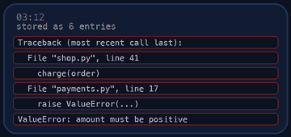

<p align="center"></p>

| | |
|-|-|
| **Time** | 75-90 min |
| **Cost** | free |
| **You need** | Bash, Python 3 and the usual Linux tools (awk, sort, uniq, grep, cut) |

## How this lab works

1. **Fork** this repository to your own GitHub account (button at the top right).
2. Clone **your fork** in your Ubuntu environment (WSL on Windows, your OrbStack machine on Mac).
3. Read the lab below (the same text is in [`LAB.md`](LAB.md)) and follow the mission.
4. Answer the questions in [`SUBMISSION.md`](SUBMISSION.md). Where a question asks for output, paste it in a code block. No screenshots needed.
5. Commit and push. Open the **Actions** tab of your fork (click *I understand my workflows, go ahead and enable them* the first time). The **Lab check** shows what is still missing.
6. When the check is green, **submit the URL of your fork** in the course platform.

> [!NOTE]
> The check only looks at your answers and any files the lab asks you to commit. Your instructor reads your work and may ask you to explain any line.

<p align="center"></p>

## 🎬 The situation

<p align="center"></p>

Tuesday morning. The overnight on-call phone rang at 03:12 and went quiet at 03:19. Nobody woke up. Monitoring shows the site "recovered by itself". The CEO wants a one-page explanation by 10:00, security noticed odd traffic and the CFO asks why the bandwidth bill grew.

All you have is the server's access log: 40,000 lines of text. Nobody is going to read that by eye. You are going to build two small tools that turn it into answers: one that **summarises** a log, one that **raises an alert** when the error rate is too high. Tools you can run on every log from now on.

> [!IMPORTANT]
> **Your mission**
> - Explore the log with the classic text tools (`grep`, `awk`, `cut`, `sort`, `uniq`)
> - Reconstruct the night: outage, scraper, password guesser, slow period
> - Write `analyze.sh` and `alert.sh` that anyone on the team can run
> - Explain the incident in a short, evidence-based timeline

**Time:** 75-90 min | **Cost:** free | **You need:** Bash, Python 3, `awk`, `sort`, `uniq` in your Ubuntu environment

<p align="center"></p>

## Part 0 - Set the scene

Fork this repository, clone your fork, and run:

```bash
./setup.sh
```

You get `data/access.log`. Every line looks like this:

```text
192.0.2.42 - - [10/Nov/2026:00:00:03 +0000] "GET /healthz HTTP/1.1" 200 60 "-" "kube-probe/1.30" 0.005
```

In order: client IP, two unused fields, time, request (method, path, protocol), status, bytes, referrer, user agent, and the **request time in seconds**.

<p align="center"></p>

## Part 1 - Recon: learn the format with your own eyes

<p align="center"></p>

Do these by hand in the terminal first. Do not write a script yet.

1. How many lines are there? (`wc -l`) What are the first and last timestamps? (`head -1`, `tail -1`)
2. `awk '{print $9}' data/access.log | sort | uniq -c | sort -rn`: what does each stage of the pipeline do? Run it one stage at a time and watch the output change.
3. How many requests failed with a 5xx status? Is that a lot? (Percentage, not count.)
4. Which `awk` field numbers hold the IP, the time, the method, the path and the status? Print each one for the first three lines.

> [!NOTE]
> **Predict** Out of all requests, what percentage are 5xx? Write a number, then compute it.

> [!NOTE]
> **Think** Why does `sort | uniq -c | sort -rn` appear in nearly every log analysis? What breaks if you forget the first `sort`?

<p align="center"></p>

## Part 2 - Investigate: the four stories

Use your pipelines to answer, and keep the commands. They go into your submission.

1. **The outage.** Which requests returned 5xx? Which path? Print only the time (hour and minute) of every 5xx and count them per minute. When did it start, when did it end, and which minute was the worst?
2. **The scraper.** Which IP made by far the most requests? What is its user agent? What status codes does it get? Look at the paths it requests: are they paths real users would visit? How can you tell a bot from a busy customer?
3. **The password guesser.** Which requests return 401? To which path, from which IP, at what time of day? How many in how many minutes?
4. **The slow hour.** The last field is the request time. Which requests took more than 3 seconds? Which path, which time window? (Hint: `awk '$NF > 3'`.)

> [!WARNING]
> **Break it** Your colleague says "the 5xx at 03:12 were a DDoS". Use the data to argue for or against: how many different client IPs hit the failing endpoint during the outage, compared with a normal hour?

<p align="center"></p>

## Part 3 - Build analyze.sh

`analyze.sh <logfile>` prints **exactly** this format (the tests compare it line by line):

```text
TOTAL 47620
STATUS 2xx 18307
STATUS 3xx 23022
STATUS 4xx 5179
STATUS 5xx 1112
TOP_IPS
3500 198.51.100.77
600 203.0.113.9
259 10.20.1.98
253 10.20.5.26
249 10.20.5.248
TOP_5XX_PATHS
1112 /shorten
PEAK_5XX_MINUTE 03:15 187
```

(The numbers above are for the log you generated. Yours must work for any log.)

Rules:

- `TOP_IPS` and `TOP_5XX_PATHS` show up to five lines: count, then the value. Highest count first; on a tie, sort the value alphabetically.
- `PEAK_5XX_MINUTE` is the `HH:MM` with the most 5xx and its count. If there are no 5xx at all print `PEAK_5XX_MINUTE none 0`, and `TOP_5XX_PATHS` has no lines.
- Always print the four `STATUS` lines, even when a class has 0.
- No argument: print a usage message to stderr and exit **2**. File missing or unreadable: an error on stderr and exit **2**.
- Start with `set -euo pipefail`.

Build it one section at a time, run it after each addition. Tip: every section is a pipeline you already wrote in Part 1 and 2.

<p align="center"></p>

## Part 4 - Build alert.sh

`alert.sh <logfile> <threshold-percent>` decides whether the error rate is too high:

- Compute the percentage of requests with a 5xx status.
- If it is **greater than** the threshold: print `ALERT: ...` with the numbers and exit **1**.
- Otherwise print `OK: ...` and exit **0**.
- Wrong number of arguments: usage, exit **2**.

> [!NOTE]
> **Think** Why use the exit code instead of only printing text? Imagine the script running from cron every minute and from a CI pipeline step: what does each one do with a non-zero exit code? What threshold would you set for Clipstr, and what would a threshold that is too low cost the team?

<p align="center"></p>

## Part 5 - Prove it

<p align="center"></p>

```bash
./verify.sh
```

It tests both scripts on your incident log **and on logs it generates just now with different data**, so hard-coded answers will fail.

<p align="center"></p>

## Level up (optional)

- **Per-hour traffic chart.** Print a text bar chart of requests per hour with `awk` and `printf`. When is the quiet period?
- **Block list.** Write `suspects.sh` that prints every IP with more than 500 requests or more than 100 `401` responses.
- **Rotate-proof.** Make `analyze.sh` read standard input when the file is `-`, so `zcat access.log.gz | ./analyze.sh -` works.
- **Real tools.** `goaccess` and `lnav` do this interactively. Which of your pipelines would you replace by them, and which would you keep for automation?

<!-- teardown:start (generated by labs.py, do not edit) -->
## Tear down (mandatory)

<p align="center"></p>

Resources left behind cost money, keep doors open and pollute the next lab. Removing what you created is part of the job, so it is part of the submission: **you must prove it is gone**.

Do this **last**, after you have pasted your `verify` output into `SUBMISSION.md` (once you tear down, the lab can no longer be verified).

1. Run `./teardown.sh`. It deletes the generated `data/` folder.

Then run the proof:

```bash
./verify-teardown.sh
```

It prints a list of checks and must end with **TEARDOWN VERIFIED**. If it reports leftovers, remove them and run it again. Paste the full output in your submission.
<!-- teardown:end -->

<!-- submission:start (generated by labs.py, do not edit) -->
## 📬 Submission

Answer the questions in `SUBMISSION.md` in **your fork** (paste output in code blocks where asked), push, then submit the **URL of your fork**.

**Files to commit**

- `analyze.sh` and `alert.sh`: your two scripts, committed to the repo

**Questions to answer**

1. Tell the story of the night in 5-8 lines: when did the outage start and end, which endpoint failed, and what was the peak minute? Back every claim with the command that produced it.
2. Which IP is scraping Clipstr and how do you know it is a bot and not a busy customer? Which IP is attacking the admin login and what evidence shows it?
3. Paste your `analyze.sh` output for the log. Which one pipeline in the script are you proudest of, and why does `sort | uniq -c | sort -rn` appear so often?
4. What exit code does `alert.sh` use and why does that matter to a cron job or a CI pipeline? What threshold would you choose for production and why?
5. What would you change to run this on a log that is 50 GB instead of 5 MB?
6. Paste the output of `./verify.sh`. It must end with **ALL CHECKS PASSED**.
7. **Tear down.** Paste the output of `./verify-teardown.sh`. It must end with **TEARDOWN VERIFIED**.
<!-- submission:end -->
